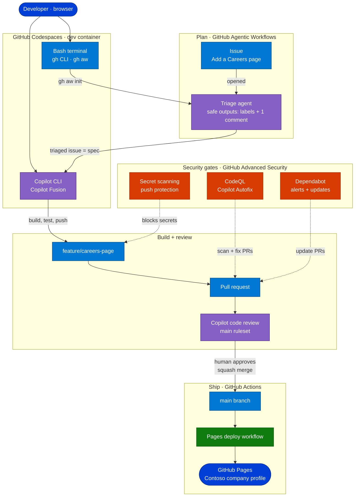

# Ship It, Dewi! — GitHub, GitHub Copilot and the agent-native SDLC

**[Ship It, Dewi!](https://ibranibeny.github.io/gh-agentic-engineering-comic/)** is an interactive, click-through anime comic about GitHub, GitHub Copilot and the agent-native software development lifecycle (SDLC). You follow Dewi, a new developer on the digital team at Contoso Technology Solutions (a fictional IT solution provider in Jakarta), as she and her mentor Maya take the company agent-native. The CTO wants every team on an agent-native engineering system, safely; the Chief People Officer needs a Careers page to hire 120 engineers; and the CISO lets nothing ship until it passes his security gates.

The comic has **15 episodes in two seasons** (about 43 minutes of reading). Season 1 teaches the concepts; Season 2 retells the real hands-on workshop **[Ship Contoso's company profile the agent-native way](https://ibranibeny.github.io/gh-agentic-engineering-workshop/)**, one chapter per episode, with real screenshots, copy-ready commands and a link to the matching chapter so you can do it yourself. In the workshop, Dewi is you.

> Tap or click to advance, press ← to go back, `L` for the story log, `A` for auto-play, `T` for the text version and `F` for full screen. Every episode has a plain text version and ends with a short quiz.

## Season 1 · Learn the concepts

Eight short episodes. Maya explains one concept at a time with a whiteboard and a good metaphor.

| Ep | Episode | Concept | Read |
|---|---|---|---|
| 1 | [Hello, GitHub!](https://ibranibeny.github.io/gh-agentic-engineering-comic/s1e1.html) | Git, GitHub and GitHub Copilot in one coffee break | 4 min |
| 2 | [From issue to production](https://ibranibeny.github.io/gh-agentic-engineering-comic/s1e2.html) | Issues, pull requests and the CI/CD pipeline | 3 min |
| 3 | [The automation factory](https://ibranibeny.github.io/gh-agentic-engineering-comic/s1e3.html) | GitHub Actions: events, workflows, jobs, steps and runners | 3 min |
| 4 | [Agents on autopilot](https://ibranibeny.github.io/gh-agentic-engineering-comic/s1e4.html) | GitHub Agentic Workflows and safe outputs | 4 min |
| 5 | [Fusion!](https://ibranibeny.github.io/gh-agentic-engineering-comic/s1e5.html) | Copilot Fusion routes and combines models for you | 3 min |
| 6 | [A second pair of eyes](https://ibranibeny.github.io/gh-agentic-engineering-comic/s1e6.html) | Copilot code review | 3 min |
| 7 | [Rusty's revenge](https://ibranibeny.github.io/gh-agentic-engineering-comic/s1e7.html) | Dependabot alerts, security updates and version updates | 3 min |
| 8 | [Raka's gates](https://ibranibeny.github.io/gh-agentic-engineering-comic/s1e8.html) | GitHub Advanced Security: Secret Protection and Code Security | 4 min |

## Season 2 · The workshop story

Seven episodes, one per workshop chapter. Set up, plan, build and review ship the Careers page in the first four chapters; secure, update and govern get the CISO's sign-off in the last three.

| Ch | Episode | Workshop chapter | What happens | Hands-on |
|---|---|---|---|---|
| 1 | [Mission: go live](https://ibranibeny.github.io/gh-agentic-engineering-comic/s2e1.html) | [Prepare the GitHub repo](https://ibranibeny.github.io/gh-agentic-engineering-workshop/chapter-1.html) | Create a public repo from the starter template (site, tests, Pages workflow, dev container) and deploy it to GitHub Pages with GitHub Actions. | 20 min |
| 2 | [The triage agent](https://ibranibeny.github.io/gh-agentic-engineering-comic/s2e2.html) | [Agentic SDLC in a codespace](https://ibranibeny.github.io/gh-agentic-engineering-workshop/chapter-2.html) | Open a codespace, install `gh aw`, and describe an issue-triage agentic workflow to Copilot CLI. Its safe outputs allow only labels and one comment. | 45 min |
| 3 | [Fusion builds the Careers page](https://ibranibeny.github.io/gh-agentic-engineering-comic/s2e3.html) | [Build with Copilot Fusion](https://ibranibeny.github.io/gh-agentic-engineering-workshop/chapter-3.html) | Switch Copilot CLI to Copilot Fusion; use the triaged issue as the spec to branch, build, test and open a pull request, then stop before merging. | 30 min |
| 4 | [Second pair of eyes](https://ibranibeny.github.io/gh-agentic-engineering-comic/s2e4.html) | [Copilot code review](https://ibranibeny.github.io/gh-agentic-engineering-workshop/chapter-4.html) | Request a Copilot review, act on it, and add a `main` ruleset that requests Copilot review on every pull request. Squash-merge and the page deploys. | 25 min |
| 5 | [Raka's office](https://ibranibeny.github.io/gh-agentic-engineering-comic/s2e5.html) | [Code security](https://ibranibeny.github.io/gh-agentic-engineering-workshop/chapter-5.html) | CodeQL default setup finds an XSS bug in legacy code, Copilot Autofix fixes it, and push protection blocks a (dummy) secret. | 35 min |
| 6 | [Rusty's last stand](https://ibranibeny.github.io/gh-agentic-engineering-comic/s2e6.html) | [Dependabot](https://ibranibeny.github.io/gh-agentic-engineering-workshop/chapter-6.html) | Dependabot alerts and security updates patch a critical `ejs` advisory; `dependabot.yml` adds grouped weekly updates for npm and GitHub Actions. | 30 min |
| 7 | [Launch!](https://ibranibeny.github.io/gh-agentic-engineering-comic/s2e7.html) | [GitHub Advanced Security](https://ibranibeny.github.io/gh-agentic-engineering-workshop/chapter-7.html) | Review everything in Security and quality, and map what was free on a public repo to what private repos need. | 20 min |

## Architecture

The workshop builds an agent-native delivery loop around one public repository: agents do the busywork, people review and decide, and security gates guard `main`.

| Layer | What it does in the workshop |
|---|---|
| **GitHub Codespaces** | A cloud dev environment built from the repo's dev container (Node.js 22 and the GitHub CLI). Two terminals: bash for commands, Copilot CLI for prompts. |
| **GitHub Agentic Workflows** | A triage agent written in plain language with Copilot CLI and compiled to a `.lock.yml`. It runs on every new issue and can only add 1–3 labels and post one comment (safe outputs), using the built-in `GITHUB_TOKEN`. |
| **Copilot Fusion** | Routes the Careers page task to a suitable model, creates the branch, keeps content in `src/data/careers.json`, runs the tests and opens a pull request — without merging. |
| **Copilot code review** | Reviews every pull request to `main` through a ruleset. Copilot comments; the human still approves. |
| **GitHub Advanced Security** | CodeQL default setup and Copilot Autofix, secret scanning with push protection, and Dependabot alerts, security updates and grouped version updates. |
| **GitHub Actions + Pages** | The deploy workflow publishes the Contoso company profile to GitHub Pages on every merge to `main`. |

## About the workshop

The comic follows a real, hands-on workshop: **Ship Contoso's company profile the agent-native way**. You create a repository from a template, deploy it to GitHub Pages, let an agentic workflow triage issues, build a feature with Copilot Fusion, review it with Copilot, and secure it with GitHub Advanced Security and Dependabot.

- About **3.5 hours** of hands-on time, as one continuous story
- **42 guided steps** with real, annotated screenshots and copy-ready commands
- **Tested end to end** in a fresh repository made from the template
- You need a **GitHub account**, a **GitHub Copilot plan**, **GitHub Codespaces** and a **browser**

On a public repository, secret scanning, push protection, CodeQL, Copilot Autofix and Dependabot are free. Private repositories need GitHub Secret Protection and GitHub Code Security; Dependabot is included on every plan; Copilot Fusion, Copilot code review and agentic workflows run on a Copilot plan and AI credits.

Contoso and all characters are fictional, and the artwork was generated with AI. This is not an official GitHub publication.

## Open it

👉 **[Read Ship It, Dewi! ↗](https://ibranibeny.github.io/gh-agentic-engineering-comic/)**

- [Hands-on workshop guide ↗](https://ibranibeny.github.io/gh-agentic-engineering-workshop/)
- [Command sheet ↗](https://ibranibeny.github.io/gh-agentic-engineering-workshop/commands.html)
- [Test run report ↗](https://ibranibeny.github.io/gh-agentic-engineering-workshop/test-run.html)
